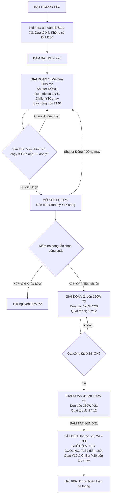

# SỔ TAY HƯỚNG DẪN TEST & VẬN HÀNH HỆ THỐNG ĐÈN UV (MITSUBISHI FX2N)
*Tài liệu chuẩn hóa quy trình kiểm tra thực tế trên tủ điện & giám sát trên GX Works2*

---

## 📌 SƠ ĐỒ NGUYÊN LÝ HOẠT ĐỘNG TỔNG QUAN



---

## 🛠 BẢNG ĐIỀU KIỆN MÔ PHỎNG / TEST TẠI CHỖ (PRE-CHECK)

Khi test thử nghiệm trên bàn mô phỏng hoặc test khi chưa nối đầy đủ ngoại vi, cần đảm bảo các tín hiệu liên động an toàn sau ở mức **ON** (tiếp điểm đóng kín):

| Ký hiệu | Tên thiết bị / Chức năng | Trạng thái bắt buộc để cho phép chạy |
| :---: | :--- | :---: |
| **X003** | Nút Dừng khẩn cấp (E-Stop) | **Nhả ra (tiếp điểm bình thường)** |
| **X004** | Công tắc cửa tủ điện nguồn | **ON (Cửa đóng kín)** |
| **X005** | Cảm biến cửa nạp phôi | **ON (Cửa đóng kín)** |
| **X010** | Công tắc áp suất gió (Air Pressure Switch) | **ON (Đủ áp suất gió làm mát)** |
| **X011** | Limit switch bảo vệ buồng chiếu | **ON (Buồng chiếu đúng vị trí, an toàn)** |
| **X016** | Cảm biến lưu lượng dòng chảy nước (Flow Switch) | **ON (Đủ nước giải nhiệt Chiller)** |
| **X030** | Tín hiệu Chiller đang hoạt động | **ON (Chiller sẵn sàng)** |
| **X031** | Tín hiệu báo lỗi Chiller | **OFF (Không có lỗi)** |

---

## 📋 QUY TRÌNH TEST THỰC NGHIỆM CHI TIẾT (6 BƯỚC)

---

### BƯỚC 1: CẤP NGUỒN & KIỂM TRA TRẠNG THÁI AN TOÀN
* **Mục tiêu:** Đảm bảo hệ thống sạch lỗi trước khi phát xung bật đèn.
* **Thao tác:**
  1. Gạt PLC sang chế độ **RUN**.
  2. Quan sát Timer `T0` đếm đủ 2.0 giây (`K20`).
  3. Kiểm tra cờ lỗi tổng hợp `M180` và đèn báo lỗi `Y000`: **Phải bằng 0 (OFF)**.
  4. Kiểm tra cụm ngõ ra hiển thị mã lỗi `Y024 ~ Y027`: **Toàn bộ phải TẮT (Mã 0)**.
* **Nếu có lỗi:** Còi `Y001` sẽ kêu. Nhấn nút Tắt còi `X022` để ngắt tiếng hú, kiểm tra nguyên nhân theo bảng mã lỗi ở Mục 4, sau đó nhấn nút Reset `X023`.

---

### BƯỚC 2: KHỞI ĐỘNG MỒI ĐÈN Ở CÔNG SUẤT 80W (STANDBY WARM-UP)
* **Mục tiêu:** Kích mồi hồ quang đèn UV, kiểm tra chế độ khởi động mềm 30 giây.
* **Thao tác:**
  1. Nhấn nút Bật đèn: Kích xung **`X020 = ON`** (sau đó nhả ra).
* **Kết quả cần quan sát trên tủ / GX Works2:**
  * ✅ Cờ trạng thái đèn `M520 = 1` (tự giữ).
  * ✅ Ngõ ra khởi động đèn **`Y002 = ON`** (Đèn UV sáng ở công suất 80W).
  * ✅ Ngõ ra quạt hút chính **`Y010 = ON`** & Đèn báo UV **`Y015 = ON`**.
  * ✅ Ngõ ra quạt tốc độ cấp 1 **`Y011 = ON`** (Quạt quay êm, gió vừa phải).
  * ✅ Ngõ ra Chiller **`Y030 = ON`** (Bơm nước làm mát chạy).
  * ✅ Cửa chập Shutter **`Y007 = OFF`** (Cửa chập che kín bóng đèn).
  * ✅ Timer **`T140`** bắt đầu đếm từ 0 đến 300 (30.0 giây sấy nóng).
* **Ghi nhận thành công:** Sau đúng 30 giây, cờ `M540 = ON` (Xác nhận đèn đã đạt nhiệt độ và cường độ quang thông ổn định).

---

### BƯỚC 3: MỞ CỬA CHẬP SHUTTER & LÊN CẤP CÔNG SUẤT 120W
* **Mục tiêu:** Đưa đèn vào chế độ sấy phôi tiêu chuẩn.
* **Thao tác:**
  1. Kích hoạt tín hiệu máy chính chạy: **`X006 = ON`**.
  2. Đảm bảo cửa phôi đã đóng: **`X005 = ON`**.
  3. Cấp tín hiệu Shutter trễ: **`X025 = ON`**.
* **Kết quả cần quan sát:**
  * ✅ Lệnh mở Shutter trễ `Y022 = ON`, kích van khí nén Shutter **`Y007 = ON`**.
  * ✅ Cảm biến báo Shutter mở `X012 = ON` (đồng thời `X013 = OFF`).
  * ✅ Đèn báo sẵn sàng **`Y016 = ON`** (Standby).
  * ✅ Ngay khi `Y007 = ON` (nếu không khóa nấc 80W `X027 = OFF`):
    * Ngõ ra tăng công suất **`Y003 = ON`** (Đèn chuyển sang nấc **120W**).
    * Đèn báo công suất **`Y020 = ON`** (Báo 120W sáng trên mặt tủ).
    * Quạt hút tự động nhảy sang cấp tốc độ cao **`Y012 = ON`** (Đồng thời `Y011 = OFF`).
* **Ghi nhận thành công:** Cường độ sáng của đèn UV tăng rõ rệt, quạt hút tăng tốc nghe tiếng gió mạnh hơn.

---

### BƯỚC 4: KÍCH TĂNG LÊN CẤP CÔNG SUẤT CỰC ĐẠI 160W
* **Mục tiêu:** Kiểm tra chế độ sấy tốc độ cao (Max Power).
* **Thao tác:**
  1. Gạt công tắc chọn công suất 160W: **`X024 = ON`** (`ランプ160W`).
* **Kết quả cần quan sát:**
  * ✅ Ngõ ra tăng công suất cực đại **`Y004 = ON`** (Cả `Y002`, `Y003`, `Y004` đều kích).
  * ✅ Đèn báo nấc 160W **`Y021 = ON`** (Sáng trên mặt tủ).
  * ✅ Quạt hút tiếp tục duy trì tốc độ cao **`Y012 = ON`**.
  * ✅ Chiller `Y030` duy trì tuần hoàn nước lạnh.
* **Ghi nhận thành công:** Hệ thống đạt 100% công suất làm việc.

---

### BƯỚC 5: KIỂM TRA LIÊN ĐỘNG AN TOÀN SHUTTER (RỚT CÔNG SUẤT TỰ ĐỘNG)
* **Mục tiêu:** Kiểm tra tính năng bảo vệ chống cháy phôi khi dây chuyền dừng.
* **Thao tác:**
  1. Đang ở nấc 160W (`Y004 = ON`), ngắt tín hiệu máy chính: Chuyển **`X006 = OFF`** (hoặc ngắt `X025 = OFF`).
* **Kết quả cần quan sát:**
  * ✅ Cuộn hút Shutter ngắt: **`Y007 = OFF`** (Cửa chập đóng sập lại che tia UV).
  * ✅ Cảm biến `X013 = ON` (Shutter đóng), đèn báo chạy `Y017 = ON`.
  * ✅ **LẬP TỨC `Y003 = OFF` và `Y004 = OFF`**.
  * ✅ Đèn UV tự động rớt về nấc cầm chừng **80W** (Chỉ còn duy nhất `Y002 = ON`).
  * ✅ Quạt hút tự động giảm về tốc độ êm **`Y011 = ON`** (`Y012 = OFF`).
* **Ý nghĩa:** Đây là tính năng sống còn giúp không bị nổ bóng, không tích nhiệt làm cháy biến dạng sản phẩm trong buồng sấy khi dừng chuyền.

---

---

### BƯỚC 6: TẮT ĐÈN & CHU TRÌNH GIẢI NHIỆT SAU (AFTER-COOLING 180 GIÂY)
* **Mục tiêu:** Kiểm tra chu trình làm mát cưỡng bức bảo vệ tuổi thọ bóng đèn.
* **Thao tác:**
  1. Nhấn nút Tắt đèn: Kích xung **`X021 = ON`** (sau đó nhả ra).
* **Kết quả cần quan sát:**
  * ✅ Toàn bộ ngõ ra đèn UV tắt ngay lập tức: **`Y002 = OFF`**, **`Y003 = OFF`**, **`Y004 = OFF`**, cờ `M520 = OFF`.
  * ✅ Xung `M560` kích hoạt cờ duy trì làm mát `M561 = ON`.
  * ✅ Timer **`T130`** bắt đầu đếm lùi thời gian giải nhiệt 180 giây (`K1800` = 3 phút).
  * ✅ **Quạt hút `Y010` và Chiller `Y030` VẪN TIẾP TỤC CHẠY** dù đèn đã tắt.
  * ✅ Sau khi đủ 180 giây: `T130` tác động $\rightarrow$ Cắt toàn bộ `Y010`, `Y030`, hệ thống dừng hoàn toàn êm ái.

---

## 💨 HƯỚNG DẪN TEST & NGUYÊN LÝ 2 VAN XẢ KHÍ DAMPER (Y005 & Y006)

Van Xả 1 (`Y005`) và Van Xả 2 (`Y006`) trong tiếng Nhật gốc là **排気ダンパー1 / 2 (Exhaust Damper 1 & 2)** — tức là **Van điện từ khí nén đóng/mở cửa xả khí thải của buồng chiếu UV**.

### 1. Nhiệm vụ sống còn của 2 van xả:
* **Hút xả khí Ozone ($O_3$) độc hại:** Tia UV năng lượng cao ion hóa oxy trong không khí tạo ra khí Ozone ($O_3$) mùi hắc, gây độc hô hấp và ăn mòn thiết bị. Van xả mở ra để quạt hút `Y010` tống toàn bộ khí này ra ống thải nhà xưởng.
* **Giải nhiệt cưỡng bức:** Thoát luồng nhiệt cực lớn do bóng UV tỏa ra, chống làm cháy/cong vênh phôi sấy và bảo vệ tuổi thọ chóa phản xạ.
* **Tối ưu lực hút theo vị trí:** Quạt hút dùng chung 1 động cơ. Bằng cách dùng van đóng/mở theo vị trí, hệ thống dồn 100% lưu lượng gió vào đúng khoang đang làm việc thay vì bị chia sẻ phân tán.

### 2. Nguyên lý điều khiển trong PLC FX2N:
* `X014 = ON` (Cảm biến vị trí buồng 1) $\rightarrow$ Kích mở Van gió buồng 1 **`Y005 = ON`**.
* `X015 = ON` (Cảm biến vị trí buồng 2) $\rightarrow$ Kích mở Van gió buồng 2 **`Y006 = ON`**.
* *Lưu ý:* Cả 2 van đều nằm dưới sự bảo vệ của khối Master Control N0 (`M189`), tức là **cửa tủ điện nguồn `X004` phải đóng kín** thì van mới mở được.

### 3. VẬY LÚC NÀO CẢ 2 VAN XẢ CÙNG MỞ? (`Y005 = ON` VÀ `Y006 = ON`)
Về mặt logic PLC, cả 2 van cùng mở khi và chỉ khi:
$$\text{\textbf{X014 = ON}} \quad \text{VÀ} \quad \text{\textbf{X015 = ON}} \quad (\text{kèm cửa tủ } X004 \text{ đóng kín})$$

Trong thực tế sản xuất, điều này xảy ra ở các trường hợp sau:
1. **Sấy sản phẩm kích thước lớn / Phôi dài:** Khi sản phẩm có kích thước dài bao phủ cả 2 khoang chiếu xạ, phôi sẽ kích hoạt cùng lúc cả 2 cảm biến vị trí `X014` VÀ `X015`. Lúc này cả 2 van xả `Y005` và `Y006` cùng bung mở tối đa để hút khí và giải nhiệt đồng đều trên toàn bộ bề mặt phôi.
2. **Dây chuyền nạp phôi liên tục (Dual Station):** Cả 2 trạm làm việc (Station 1 & Station 2) đều đang có đồ gá phôi nằm trong vùng sấy.
3. **Cụm đèn UV ở vị trí trung tâm (Center / Overlap):** Cụm đèn di chuyển nằm ở vị trí giao thoa giữa 2 buồng, kích hoạt cùng lúc 2 công tắc cữ hành trình `X014` và `X015`.

### 4. Các bước thao tác test thực tế trên bàn / GX Works2:
| Bước Test | Thao tác kích tín hiệu (Input) | Kết quả quan sát (Output) | Ý nghĩa kiểm tra |
| :--- | :--- | :--- | :--- |
| **Test Van 1** | Kích `X014 = ON`, `X015 = OFF` | **`Y005 = ON`**, `Y006 = OFF` | Van gió buồng 1 mở độc lập |
| **Test Van 2** | Kích `X014 = OFF`, `X015 = ON` | `Y005 = OFF`, **`Y006 = ON`** | Van gió buồng 2 mở độc lập |
| **Test CẢ 2 VAN**| Kích đồng thời **`X014 = ON` VÀ `X015 = ON`** | **CẢ HAI `Y005 = ON` VÀ `Y006 = ON`** | Cả 2 van cùng bung mở (Chế độ sấy phôi dài / 2 khoang) |
| **Test An toàn** | Đang mở cả 2 van, mở cửa tủ (`X004 = OFF`) | **LẬP TỨC `Y005 = OFF` VÀ `Y006 = OFF`** | Khối Master Control N0 ngắt bảo vệ an toàn |

---

## 🔍 BẢNG TRA CỨU MÃ LỖI 7 ĐOẠN (ERROR CODES)

Khi hệ thống gặp sự cố, cờ `M180` bật ON, còi `Y001` hú, và 4 ngõ ra `Y024 ~ Y027` sẽ xuất mã nhị phân tương ứng với số hiển thị trên LED 7 đoạn:

| Mã lỗi | Trọng số ngõ ra (Y27-Y26-Y25-Y24) | Tên lỗi & Ý nghĩa kỹ thuật | Vị trí kiểm tra thực tế |
| :---: | :---: | :--- | :--- |
| **0** | `0 0 0 0` | Hệ thống bình thường (Normal) | Không có sự cố |
| **1** | `0 0 0 1` | **Lỗi chấn lưu / Ballast (`M0`)** | Điện áp nuôi đèn thấp hơn ngưỡng (`X001`) hoặc vượt ngưỡng (`X002`) |
| **2** | `0 0 1 0` | **Lỗi quạt hút thông gió (`M10`)** | Rơ le nhiệt bảo vệ quạt hút nhảy, đứt cầu chì hoặc mất pha (`X000`) |
| **3** | `0 0 1 1` | **Lỗi mất áp suất gió (`M20`)** | Công tắc áp suất gió hở (`X010`), nghẹt đường ống gió hoặc quạt yếu |
| **4** | `0 1 0 0` | **Lỗi liên động buồng UV (`M30`)** | Công tắc hành trình buồng chiếu `X011` bị hở/kẹt |
| **5** | `0 1 0 1` | **Lỗi kẹt cửa chập Shutter (`M40`)** | Sau 5 giây mở/đóng mà cảm biến `X012`/`X013` không nhận tín hiệu |
| **6** | `0 1 1 0` | **Lỗi lưu lượng nước làm mát (`M60`)** | Cảm biến Flow switch `X016` báo cạn nước, nghẹt ống hoặc bơm chiller ngừng |
| **7** | `0 1 1 1` | **Lỗi Dừng khẩn cấp E-Stop (`M120`)** | Nút bấm dừng khẩn cấp `X003` đang bị nhấn giữ |
| **8** | `1 0 0 0` | **Lỗi mở cửa tủ điện nguồn (`M130`)** | Công tắc cánh tủ `X004` bị hở khi đèn đang bật |
| **9** | `1 0 0 1` | **Lỗi máy làm lạnh Chiller (`M51`)** | Máy nén chiller báo sự cố áp suất gas/quá nhiệt qua chân `X031` |

---

## 📊 CHECKLIST THEO DÕI NHANH TRÊN GX WORKS2 (WATCH LIST)

Để tiện giám sát trên màn hình máy tính khi test trực tiếp bằng cáp nạp PLC, bạn mở cửa sổ **Watch Window** trong GX Works2 và thêm danh sách các biến sau:

```text
[NHÓM ĐIỀU KHIỂN ĐÈN]
- Y002   : Khởi động đèn 80W
- Y003   : Tăng công suất 120W
- Y004   : Tăng công suất 160W
- M520   : Cờ đèn đang ON
- M540   : Cờ đèn đã ổn định nhiệt (Ready)

[NHÓM SHUTTER & CÔNG SUẤT]
- Y007   : Van mở Shutter
- X012   : Cảm biến Shutter MỞ
- X013   : Cảm biến Shutter ĐÓNG
- X024   : Công tắc chọn 160W
- X027   : Công tắc chọn 80W

[NHÓM LÀM MÁT & THỜI GIAN]
- Y010   : Quạt hút hoạt động
- Y011   : Quạt chạy cấp 1 (Êm)
- Y012   : Quạt chạy cấp 2 (Mạnh)
- Y030   : Lệnh chạy Chiller
- T140   : Thời gian sấy nóng đèn (30s)
- T130   : Thời gian giải nhiệt sau khi tắt (180s)

[NHÓM AN TOÀN & MÃ LỖI]
- M180   : Cờ báo lỗi tổng hợp
- Y000   : Đèn báo lỗi tủ
- Y001   : Còi Buzzer
- K1Y024 : Giá trị số hiển thị mã lỗi (0 - 9)
```
